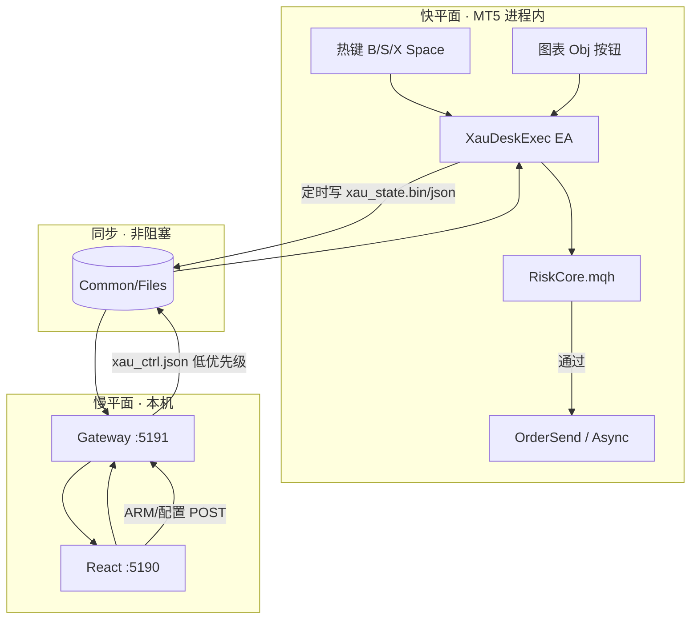

# Mac Path A 设计草案 · 低延迟执行 + React 慢路径展示

> 状态：**已决策 · P0 施工中**（分支 `feature/mt5-exec-mac`）  
> 目标读者：产品 / 开发（你在 Mac 上重构 XauDesk 实盘栈）

---

## 0. 决策摘要（先看这里）

| 决策项 | 建议 |
|--------|------|
| **下单热路径** | 仅 **MQL5 EA**（图表按钮 + 热键）；`OrderSend` 前跑硬风控 |
| **React UI** | **展示 + 配置 + 画线**；Mac 实盘默认 **关闭 UI 市价快捷键（B/S）** 或仅模拟 |
| **慢路径同步** | EA 写状态 → **Node 网关 5191**（Phase 1）→ React；后期可换 Rust 仅网关 |
| **弃用** | 文件桥 `xau_cmd.json` **不得出现在下单路径**（仅保留调试/远程助手可选） |
| **ARM** | **EA 为真源**；UI 通过慢路径 **请求** ARM，EA 可拒绝（连损/日损锁） |
| **风控真源** | Phase 1：强制 SL + Magic + 简易日损/连损；Phase 2：对齐 `risk_engine.py` 规格 |

**不建议现在做**：Rust 下单机、Socket 抢 UI 毫秒、EA 内 HTTP 服务器、Mac 上 Python `MetaTrader5`。

---

## 1. 目标与非目标

### 1.1 目标

- **成交延迟**：从用户按下 MT5 内热键/按钮 → `OrderSend` 提交，目标 **&lt;2ms 终端内**（不含券商 WAN）。
- **滑点敏感路径**：无 HTTP、无 JSON 解析、无跨进程 IPC。
- **产品一致性**：Magic `8805190`、ARM 语义、强制 SL、与 Windows 风控哲学一致（文档：`RISK_DESIGN_AND_PHILOSOPHY.md`）。
- **UI**：持仓/净值/连损 HUD **晚 50–300ms 可接受**。

### 1.2 非目标（本阶段不做）

- React 内点 Buy 与 MT5 热键 **同延迟**（除非另开路线图 2）。
- Mac 上复刻 Python 全量 `risk_engine.py` 再开发（分 Phase 移植）。
- 公网暴露 5191 无鉴权。

---

## 2. 三平面架构



**原则**：`OnChartEvent` / 按钮回调里 **只** 走 `RiskCore` + `OrderSend`；`OnTimer` 里做状态落盘与读配置，**绝不**在热路径 `FileOpen` / `WebRequest`。

---

## 3. 技术选型与理由

### 3.1 执行：MQL5（EA）— **必选**

| 理由 | 说明 |
|------|------|
| Mac 零售 MT5 **唯一**官方成交 API 所在进程 | 无 Python 包、无外部 OrderSend |
| 与原生一键同属终端进程 | 延迟下限 = 终端内置交易 |
| 可嵌入 `#include "RiskCore.mqh"` | 规则与 UI 解耦，便于 Phase 2 对齐 Python |

**不用 C++/Rust 替 EA 下单**：外部进程无法直接调 Mac 零售终端成交；Windows DLL 在 Mac 不可用；多一跳 IPC 违反 Path A。

**可选**：Windows 未来用 DLL 加速 **重计算**（情景模拟）；Mac 不依赖。

### 3.2 慢路径网关：Node（Phase 1）— **建议先用**

| 理由 | 说明 |
|------|------|
| 仓库已有 `gateway-mac/`、Vite proxy 5191 | 零新工具链，与 Windows API 形状一致 |
| 只做读盘 + HTTP + 写 `xau_ctrl.json` | 不在下单路径，p99 抖动 **不伤害成交** |
| 团队主栈 TS/React | 改 `src/api/*` 成本低 |

**Phase 3 可选 Rust 网关**：当 WebSocket 客户端 &gt;10、审计写盘成为瓶颈时再换；**不改变 EA**。

**不用 Python on Mac**：无 `MetaTrader5` 包，维护双栈无收益。

### 3.3 前端：React + Vite（保持）— **建议**

| 理由 | 说明 |
|------|------|
| 现有图表/风控 HUD 已成熟 | 只改「Mac 实盘模式」行为开关 |
| Electron 可选 | Mac 先用浏览器 `127.0.0.1:5190` 即可 |

**Mac 实盘模式（`VITE_EXECUTOR=mt5-ea`）**：

- 隐藏或禁用 UI **B/S/X** 市价热键（提示「请在 MT5 图表交易」）。
- ARM：UI 点 ARM → POST → EA 确认；EA 强制 DISARM 时 UI 跟随轮询。
- 仍允许：画线、风控参数表单、持仓列表（来自网关）。

### 3.4 EA ↔ 网关：二进制状态 + 小 JSON 控制 — **建议**

| 载体 | 用途 | 频率 |
|------|------|------|
| `xau_state.bin`（或紧凑 JSON Phase 1） | quote、account、positions、risk 摘要 | 100–250ms `OnTimer` |
| `xau_ctrl.json` | ARM、lots 预设、风控配置 patch | 事件驱动 + EA 每 500ms 读一次 |
| ~~`xau_cmd.json` 下单~~ | **禁止用于市价** | — |

**为何不用 Socket（Phase 1）**：EA 端 Socket 维护 + 协议版本增加工作量；展示延迟不敏感；Path A 下单根本不经过 Socket。

**为何不用 GlobalVariable 给 React 读**：浏览器读不了 GV；仍需网关，不如直接读文件。

### 3.5 状态与审计

| 项 | Phase 1 | Phase 2 |
|----|---------|---------|
| 拒单原因 | EA `Print` + 可选 `xau_events.jsonl` 追加 | 对齐 Python 哈希链字段 |
| `risk_state` | EA 内 `Common/Files/xau_risk_<login>.json` | 与 `risk_engine.py` 同 schema |

---

## 4. EA 模块划分（拟议文件）

```
mql5/
  Experts/
    XauDeskExec.mq5          # OnInit/OnTick/OnChartEvent/OnTimer/OnTradeTransaction
  Include/
    RiskCore.mqh             # 下单前闸门（Phase 1 简版 → Phase 2 完整）
    TradeExec.mqh            # OrderSend 模板、filling、deviation 缓存
    StatePublish.mqh         # 慢路径写状态（Timer 专用）
    CtrlConsume.mqh          # 读 xau_ctrl（Timer 专用）
    ChartPanel.mqh           # 可选 OBJ_BUTTON 买/卖/ARM
```

**与现有 `XauRiskGateway.mq5` 关系**：重命名为 `XauDeskExec.mq5` 或合并；**删除 Timer 内 `ProcessCommand` 市价路径**。

---

## 5. 热路径行为规范

### 5.1 热键（与 Windows UI 对齐，便于肌肉记忆）

| 键 | 行为 | 条件 |
|----|------|------|
| `Space` | 切换 ARM（若未日损/连损锁） | 图表焦点在 MT5 |
| `B` | 市价买 | `armed` + 已设默认 SL 规则 |
| `S` | 市价卖 | 同上 |
| `X` | 平选中 / 最近 APP Magic 仓 | `armed` |
| `1`/`2`/`3` | 切换手数预设 | 写入 EA 内存，不写盘 |

**SL 来源（Phase 1 二选一，决策点）**：

- **A**：上次 UI 同步的 `default_sl_points` / 图表上拖拽线（慢路径写入 `xau_ctrl.json`）。
- **B**：固定点数 input + 快捷键微调（纯 EA，最快）。

### 5.2 `OnTick` 缓存

- 最新 `bid`/`ask`、点差、`SymbolInfo` 交易标志在 `OnTick` 更新全局结构体。
- `OrderSend` 使用缓存价，热路径不调用 `SymbolInfoDouble` 超过必要次数。

### 5.3 风控检查顺序（与 Python 对齐意图）

1. `trading_halted`（日损 / 连损 tier / 手动）
2. `arm_state != armed`
3. 强制 SL（无 SL 拒绝）
4. 手数步进 / 最大持仓槽位（Phase 1 简化）
5. 单笔亏损上限（有 SL 时按距离估算，Phase 2 精确）

失败：**不** `OrderSend`；`OnTradeTransaction` 不背锅；可选非阻塞告警（`Comment` 或下一轮 Timer 写事件）。

---

## 6. 网关（Node）职责边界

```
GET  /api/mt5/status|quote|account|positions|orders|risk/status|bars
     ← 读 xau_state.*（bars 仍可通过 EA RPC 或 state 缓存，非热路径）

POST /api/risk/arm          → 写 xau_ctrl { "arm": true|false }
POST /api/risk/config       → 写 xau_ctrl 配置 patch
POST /api/order/*           → Mac 实盘模式返回 410 + 提示「请用 MT5 热键」
                              （或仅 dev 模拟开关允许转发）
```

**bars / quote**：可走 100–300ms 缓存；与下单无关。

---

## 7. 与 Windows 版关系

| 模块 | Windows（main） | Mac Path A |
|------|-----------------|------------|
| 下单 | Python + UI 热键 | **EA 热键** |
| 风控权威 | `risk_engine.py` | Phase 1 EA → Phase 2 规则 parity |
| 网关 | `serve_mt5.py` | `gateway-mac` 只读状态 + 写 ctrl |
| UI | 全功能 | `VITE_EXECUTOR=mt5-ea` 裁剪发单 |

长期：**共享** `docs/RISK_DESIGN` 与风控 JSON schema；双实现测试矩阵（同场景拒单/放行一致）。

---

## 8. 分阶段交付（建议排期）

| Phase | 内容 | 验收 |
|-------|------|------|
| **P0** | `XauDeskExec`：Space/B/S/X + 强制 SL + Magic；Timer 写 state；无 cmd 下单 | 策略测试器 + 模拟账户 100 笔无 HTTP |
| **P1** | Node 读 state + `VITE_EXECUTOR=mt5-ea` UI 模式 + ARM POST | UI 持仓延迟 &lt;500ms 可接受 |
| **P2** | `RiskCore` 日损/连损 tier + `xau_risk_<login>.json` | 与 Python 关键用例对照表 |
| **P3** | 可选 Rust 网关 / WebSocket 推 state | 仅当 CPU/连接数成为问题 |

---

## 9. 已拍板决策（2026-11-13）

| # | 决策 |
|---|------|
| 1 | **市价+SL**：同单 `OrderSend` 一次带上；**开仓后拖线改 SL** 走慢路径 |
| 2 | **UI B/S/X 实盘保留**；**TCP :5192 → EA**；图表 B/S 为零跳 |
| 3 | **`xau_state.bin`** + `xau_ctrl.json` |
| 4 | **限价**：FastLane `op=3` 优先 |
| 5 | 分支 **`feature/mt5-exec-mac`**，P0 已开工 |

**UI B/S/X**：浏览器 → HTTP → Node 转发 48B TCP → `OrderSend`（非原生零跳）；**MT5 图表 B/S** = 原生延迟档。

---

## 10. 风险与回退

- **EA 崩溃**：无 UI 下单兜底 → 保持 MT5 手动单不受影响（Magic 不同）；EA 重启恢复 state 文件。
- **文件桥误用**：文档与网关 **410** 阻止 UI 市价，避免团队习惯回到慢路径。
- **哲学张力**：`RISK_DESIGN` 写「不经 MT5 情绪化直连」→ Path A 是 **经 EA 硬风控的 MT5 内执行**；产品文案需改为「不经无风控的一键交易」。

---

## 11. 参考

- [MAC_VERSION.md](./MAC_VERSION.md)
- [MQL5_RISK_GATEWAY.md](./MQL5_RISK_GATEWAY.md)（端点表；Mac Path A 收缩 POST 下单）
- [RISK_DESIGN_AND_PHILOSOPHY.md](./RISK_DESIGN_AND_PHILOSOPHY.md)
- `backend/risk_engine.py`、`backend/mt5_trading.py`（`MAGIC = 8805190`）

---

**回复模板（便于你决策后开工）**：

```text
1. SL: A|B
2. 禁用 UI B/S/X: 是|否（模拟例外：是|否）
3. state: json|bin
4. 挂单: 不做|EA|UI慢路径
5. 分支: feature/mt5-exec-mac
开工从 P0 开始
```
