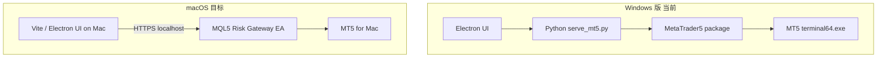

# XauDesk · macOS 专属路线（文档版）

> **当前 GitHub 默认发行版 = Windows 完整栈**（Electron + Python 网关 + `MetaTrader5` 包）。  
> **macOS 本仓库尚未包含可一键实盘的等价网关**；本文档供在 Mac 上用 Cursor 克隆本仓库，并演进 **MQL5 Risk Gateway EA** 与远程/本机 Mac UI。

## 你在 Mac 上要做什么

1. 在 Mac 安装 **Cursor**、**Node.js LTS**、**MetaTrader 5 for Mac**（券商账户已登录，开启算法交易）。
2. 克隆本仓库（与 Windows 同一开源源）：
   ```bash
   git clone https://github.com/imchriscy/xau-desk.git
   cd xau-desk
   npm install
   ```
3. **不要**指望 `pip install MetaTrader5` 在 Mac 上连接本机 MT5——官方 Python 绑定仅 Windows。
4. 按 **[MQL5_RISK_GATEWAY.md](./MQL5_RISK_GATEWAY.md)** 在 `mql5/` 下实现 EA，把今日 Windows 版 `backend/risk_engine.py` + `serve_mt5.py` 的**风控与下单语义**迁移到 MQL5。
5. 前端（React + Vite）可在 Mac 上 `npm run dev` 做 UI 重构；执行层改为调 EA 暴露的 HTTP/Socket（见下）。

## 架构对照

| 模块 | Windows 版（main，已维护） | macOS 目标（你重构） |
|------|---------------------------|----------------------|
| 桌面壳 | Electron + 桌面快捷方式 | Electron 或纯浏览器；无 `.vbs` / `.ps1` 依赖 |
| 行情 K 线 | Python → MT5 API | EA 或 Mac MT5 图表；UI 仍可用 Lightweight Charts + 自建 `/api/bars` |
| 下单 / 改 SL/TP | Python `mt5_trading.py` | **MQL5** `OrderSend` / `PositionSelect` / `OrderModify` |
| 硬风控 | `risk_engine.py` 下单前拦截 | **EA 内同等规则**（日损、连损、强制 SL、Magic、保证金预算） |
| 审计 | `risk_events.jsonl` 哈希链 | EA 写文件或 `Print` + 结构化 journal |
| 延迟 | localhost ~20ms 级 | 本机 Mac：EA 同终端最优；远程 VPS：接受 RTT |



## Mac 上现在能跑什么（不改编码）

- `npm run dev` → 仅前端 **纸面 / mock**（无 MT5 实盘通道）。
- 阅读与修改 `src/`、`docs/`、`backend/risk_engine.py`（作风控规格书，不在 Mac 执行 Python MT5）。
- 在 MT5 for Mac 里手动挂测试用 EA（待你在 `mql5/` 提交代码）。

**不能**作为生产实盘依赖的：

- `backend/serve_mt5.py` 在 Mac 上连接 MT5。
- `install-desktop.vbs`、`scripts/*.ps1`（Windows 专用）。

## 三种外出操盘拓扑（任选其一演进）

### A. 远程 Windows（改动最小）

家里或 VPS **Windows + 现有 XauDesk 常开**；Mac 通过 Tailscale / WireGuard 访问 `https://<host>:5190`（须自建 TLS 与鉴权，勿裸奔公网）。

- 优点：风控与 Magic 已与现网一致。  
- 缺点：依赖远端在线；延迟非本机环回。

### B. Mac 本机 MT5 + MQL5 EA（推荐长期目标）

Mac 安装 MT5，挂 **Risk Gateway EA**；UI 连 `127.0.0.1` EA 提供的 HTTP（需在 MT5 选项里允许 WebRequest URL）。

- 优点：外出只带 Mac，执行在本机终端内。  
- 缺点：需完整移植 `risk_engine` 与下单 API。

### C. VPS MT5 + EA，Mac 只当 UI

与 B 相同协议，EA 跑在 Windows VPS，Mac UI 远程调用。

- 参考 Windows 侧部署思路：[TMGM_VPS_DEPLOY.md](./TMGM_VPS_DEPLOY.md)（Python runner 可逐步替换为 EA）。

## 在 Mac 用 Cursor 的建议工作流

1. Clone `imchriscy/xau-desk`，打开仓库根目录。  
2. 先读 [RISK_DESIGN_AND_PHILOSOPHY.md](./RISK_DESIGN_AND_PHILOSOPHY.md) 与 `backend/risk_engine.py`。  
3. 实现 `mql5/XauRiskGateway.mq5`（见 [MQL5_RISK_GATEWAY.md](./MQL5_RISK_GATEWAY.md)）。  
4. 抽象 `src/api/mt5.ts`：增加 `VITE_EXECUTOR=mql5|python` 环境变量，Mac 指向前 EA 端口。  
5. 功能对齐清单用 CHANGELOG **Unreleased** 与 Windows 版对比勾选。

## 分支与版本策略（建议）

- **`main`**：Windows 生产可用；Python 网关为权威实现。  
- 个人 Mac 重构可用分支 `feature/mql5-mac-gateway`，成熟后再考虑合并或独立 tag `mac-preview`。  
- 文档以 `docs/MAC_VERSION.md` + `docs/MQL5_RISK_GATEWAY.md` 为 Mac 入口；Windows 用户仍以 README 快速开始为准。

## 相关链接

- 仓库：<https://github.com/imchriscy/xau-desk>  
- Windows 安装：仓库根 [README.md](../README.md)  
- EA 规格：[MQL5_RISK_GATEWAY.md](./MQL5_RISK_GATEWAY.md)
